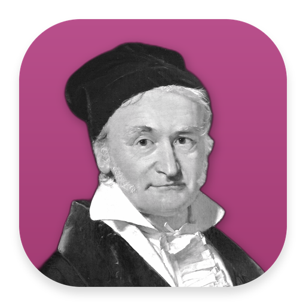
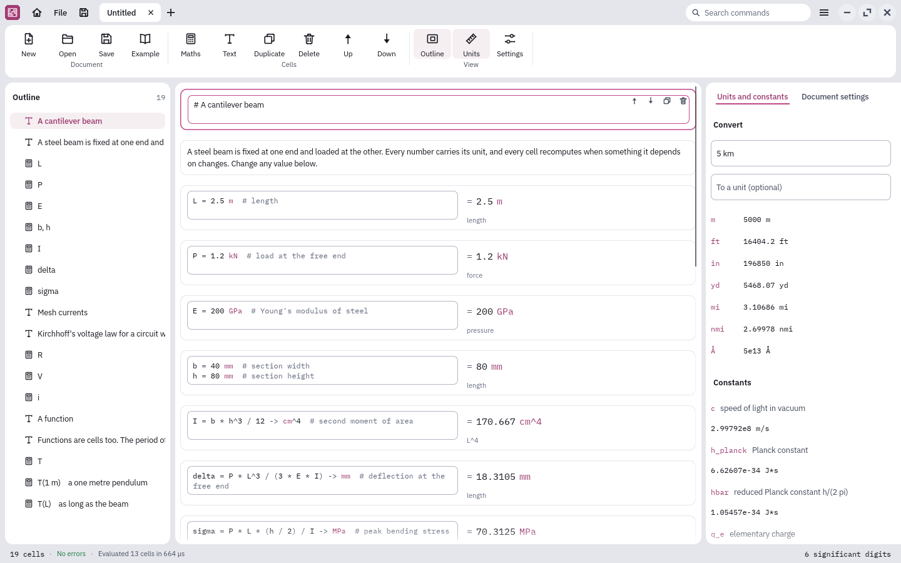
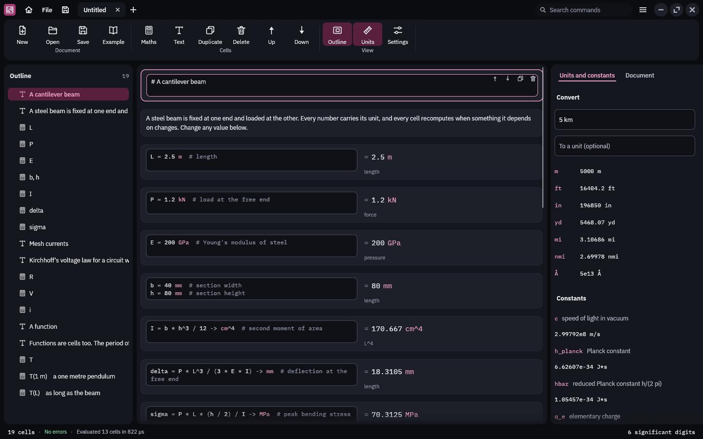
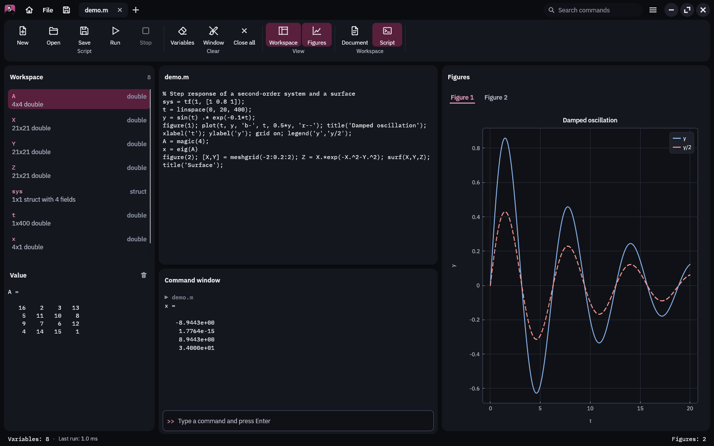
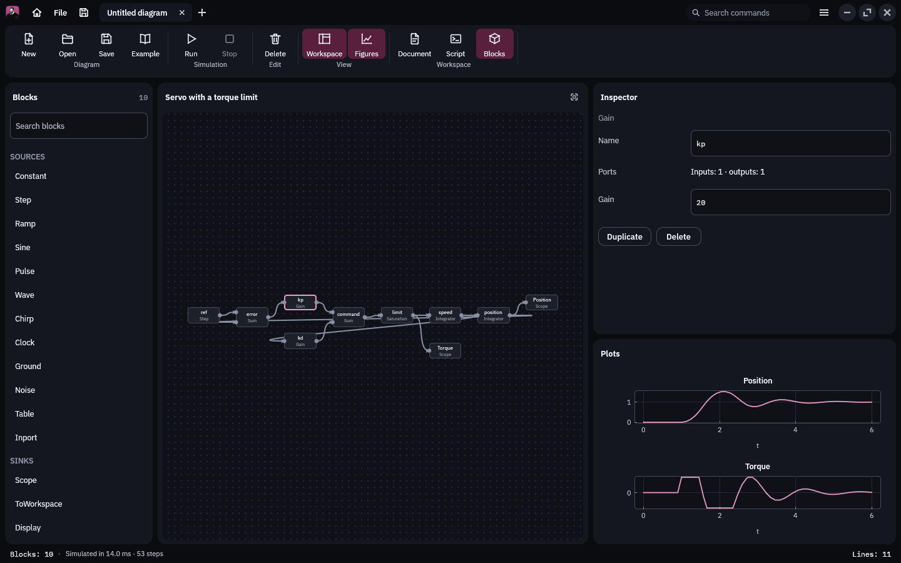
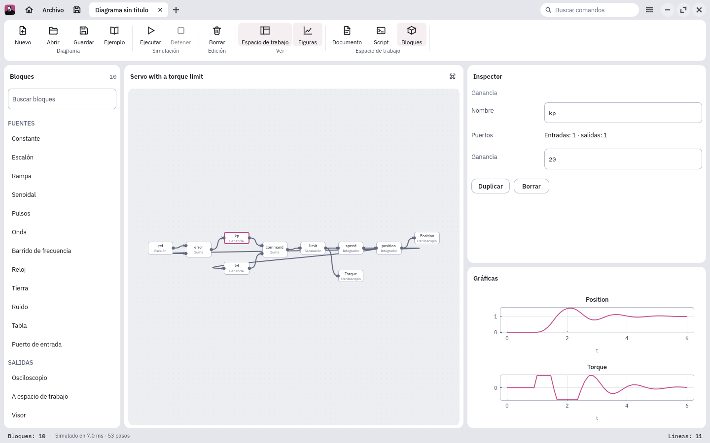

<div align="center">
  <a href="https://getnodalia.com">
    
  </a>
  <br><br>
  
  <h1>Ábaco</h1>
  <p><strong>The mathematics and scientific-computing application of the Nodalia suite.</strong></p>

  <p>
    
    
    
  </p>

  <p>
    <a href="#overview">Overview</a> ·
    <a href="#screenshots">Screenshots</a> ·
    <a href="#what-it-does">What it does</a> ·
    <a href="#download">Download</a> ·
    <a href="#build-and-run">Build</a> ·
    <a href="#command-line">Command line</a> ·
    <a href="#project-status">Status</a> ·
    <a href="#the-nodalia-suite">Suite</a> ·
    <a href="#license">License</a>
  </p>
</div>

<p align="center">
  
</p>

---

## Overview

**Ábaco** is the mathematics and scientific-computing application of [Nodalia](https://getnodalia.com):
executable maths documents in which every number carries its unit and every cell recomputes when
what it depends on changes. It is a native app written in Rust with engines of its own, with no
account and no cloud, and it wears Nodalia Design: rounded islands, the suite's line icons in
Ábaco's plum, and the suite's own window controls on Linux.

Around the document it has a matrix language in the spirit of MATLAB and a block-diagram modeller
in the spirit of Simulink, both running on solvers written for Nodalia.

> [!IMPORTANT]
> **Ábaco is at an early stage.** Expect rough edges, keep a copy of documents that matter, and do
> not use it for anything safety-critical.

## Screenshots

<table>
<tr>
<td width="50%" valign="top"><p align="center"><sub><b>Maths documents.</b> Units on every number, results beside each cell, a converter and the constants one click away.</sub></p></td>
<td width="50%" valign="top"><p align="center"><sub><b>Ábaco Script.</b> An editor, a command window, a variable browser and the figures a script draws.</sub></p></td>
</tr>
<tr>
<td width="50%" valign="top"><p align="center"><sub><b>Ábaco Blocks.</b> A library of blocks, a canvas, an inspector and the plots of the last run.</sub></p></td>
<td width="50%" valign="top"><p align="center"><sub><b>Light and dark</b>, following the system or your choice in Preferences.</sub></p></td>
</tr>
</table>

## What it does

- **Units on every number.** Dimensions, SI and common units, conversion and CODATA constants
  (`nodalia-units`). Adding metres to seconds is an error that names both dimensions, and an
  overflow is an error, never infinity.
- **An expression language** (`abaco-expr`) with units, complex numbers, vectors and matrices, user
  functions and errors that give the line and column and suggest the name you misspelt. Every input
  is bounded.
- **Maths documents** (`abaco-doc`): cells with a dependency graph, cycle detection, incremental
  evaluation and the `.abaco` file, versioned and saved atomically.
- **Numerics** (`nodalia-numerics`): dense real and complex linear algebra, root finding, adaptive
  quadrature and an adaptive ODE integrator, each tested against analytic or published values.
- **Ábaco Script** (`abaco-script`): a matrix language with scripts, functions, control flow, cells,
  structs, function handles, regular expressions, more than 350 built-in functions and plot
  commands that record figures. Reference and limits are in [`docs/script.md`](docs/script.md).
- **Ábaco Blocks** (`abaco-blocks`): block diagrams with about 60 blocks, fixed-step and
  variable-step solvers including a stiff one, exact sample and switching times, zero-crossing
  detection, algebraic-loop detection and linearisation. Reference, verification and limits are in
  [`docs/blocks.md`](docs/blocks.md).
- **The desktop app** (`abaco-app`): a document of cells with results and errors in place, an
  outline, a units panel and a converter, a script workspace (`Ctrl+J`) and a block-diagram
  workspace (`Ctrl+Shift+L`). Evaluation and simulation run on threads of their own, so typing
  never waits. English and Spanish, light and dark, and the menu exported to the top bar on Linux.

What does not exist yet is in [`ROADMAP.md`](ROADMAP.md): undo and redo in the app, exporting
figures, symbolic computation and low-level file handles in scripts.

## Download

Packages for Linux, macOS and Windows are on the
[releases page](https://github.com/getnodalia/abaco/releases/latest) and at
[getnodalia.com/abaco](https://getnodalia.com/abaco). Each package installs the app as `abaco` and
the command line as `abaco-cli`.

[Nodalia Launcher](https://getnodalia.com/launcher) installs it and keeps it up to date too.

| Platform | Files |
|---|---|
| Linux (x86_64) | `.AppImage`, `.deb`, `.rpm`, `.tar.gz` |
| macOS (universal) | `.dmg`, ad hoc signed and not notarized: open it with right click, Open |
| Windows (x64) | `.msi` (for one account or for everyone) and a `-portable.zip`, unsigned: SmartScreen warns the first time |

## Build and run

You need a recent stable Rust toolchain. On Linux, the app also needs `libxkbcommon-x11-0` and
`libegl1` at run time.

```bash
git clone https://github.com/getnodalia/abaco.git
cd abaco
cargo run --release -p abaco-app
```

The gate that CI runs:

```bash
cargo fmt --all -- --check && cargo clippy --workspace --all-targets --locked -- -D warnings && cargo test --workspace --locked
```

## Command line

`abaco` evaluates, runs and simulates without the interface: `eval`, `run FILE`, `script FILE`,
`sim MODEL.json`, `repl`, `functions` and `units`, with `--json` and `--digits N`.

```console
$ abaco eval '10 kg * 9.81 m/s^2 -> N'
98.1 N
$ abaco eval '100 degC -> degF'
212 degF
$ abaco eval '5 m + 3 s'
error: cannot add m and s (length and time)
```

## Project status

| Area | State |
|---|---|
| Engines (units, expressions, documents, numerics, Script, Blocks) | Working, tested against analytic or published values and fuzzed for panics |
| Desktop app | Working; run on Linux only so far; no undo in the document or the block editor |
| App icon | Done: portrait of John Napier |
| Nodalia interface | Done: Nodalia theme and icons, rounded islands, main menu, Nodalia window controls on Linux |
| Global menu | Done on Linux (D-Bus), in the top bar of the shell |
| Installable packages | Linux, macOS (DMG) and Windows, built by CI for every release |
| Symbolic computation | Planned |

## App icon

Nodalia app icons are black-and-white portraits of historical figures over the app colour.
Ábaco's is John Napier, who invented logarithms to make calculation easier. Provenance and
licence are in [`ATTRIBUTION.md`](ATTRIBUTION.md).

## The Nodalia suite

Ábaco is one of the applications of [Nodalia](https://getnodalia.com), an independent software
project developed in public by [Daniel Miguel Tejedor](https://danielmigueltejedor.com). It belongs
to the Engineering suite, with Forja, Torno, Vortia, Circuito and Código.

Contributing and agent rules are in [`AGENTS.md`](AGENTS.md); security is in
[`SECURITY.md`](SECURITY.md).

## License

`MIT OR Apache-2.0`. See [`LICENSE-MIT`](LICENSE-MIT) and [`LICENSE-APACHE`](LICENSE-APACHE).
